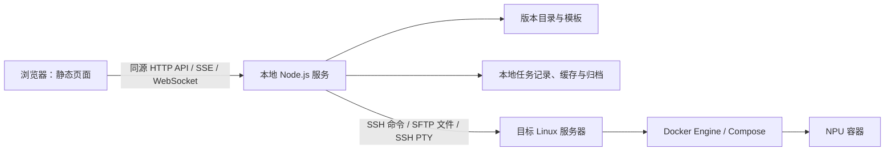
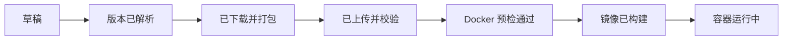

# 软件架构与模块职责

状态：首版实现基线。本文描述拟开发工具的目标架构，仓库目前尚无应用代码。

## 1. 架构决策

- **形态**：单用户本地应用。静态 HTML/CSS/JavaScript 由本地 Node.js 服务提供，浏览器访问同源的 `127.0.0.1` 页面和 API；不使用 `file://` 作为运行入口。
- **语言**：前端、本地服务和共享数据契约使用 TypeScript。Dockerfile、Compose YAML 和远端 Bash 命令是生成产物，不承载业务状态。
- **执行位置**：下载和归档在操作员电脑；上传、镜像构建、容器启动在目标 Linux 服务器；浏览器终端连接目标容器。目标服务器不安装本工具的常驻服务。
- **首版范围**：一个本地用户、同时只运行一个部署任务；允许查看多个历史任务。支持参考资料中经过核实的 Linux x86_64 / amd64、Python 3.10、Ubuntu 22.04 组合。配置中的 NPU 算子型号与目标服务器 CPU 架构分别校验。
- **输入基线**：仓库的版本目录及模板是生成依据。用户所说的“当前目录”落实为版本控制内的 `catalog/` 与 `templates/`，运行时不依赖启动命令所在目录。`reference/environment/` 保留原始脚本以便对照，不作为运行时模板直接修改。



页面不会直接访问 SSH 密钥、Docker socket 或目标服务器。Node.js 服务只监听回环地址；SSH 身份信息留在服务端进程。Compose 只在目标服务器执行，避免把远端设备节点误认为本机设备。

## 2. 模块职责与边界

| 模块 | 主要职责 | 输入 → 输出 | 明确不负责 |
| --- | --- | --- | --- |
| `web` 页面 | 配置向导、文件链接与生成文件预览、任务进度、日志、终端界面 | 用户配置/API 事件 → 操作请求/展示 | 下载大文件、保存 SSH 凭据、执行系统命令 |
| `api` 本地接口 | 静态文件、配置校验入口、HTTP API、SSE、终端 WebSocket、同源与会话校验 | HTTP/WS 请求 → 结构化响应/事件 | 具体下载、SSH 或 Docker 逻辑 |
| `shared` 契约 | 配置 schema、版本与任务类型、错误码、输入规范化 | 原始输入 → 已验证的领域数据 | IO 和命令执行 |
| `catalog` 版本目录 | 解析 Toolkit 版本、NPU 型号、CPU 架构及配套 Torch/TorchNPU；产出四个文件的可信 URL、名称、兼容性与校验信息 | 版本选择 → `ArtifactSet` | 猜测未知版本 URL、实际下载 |
| `bundle` 文件准备 | 流式下载/缓存、大小与 SHA256 核验、清单和归档生成、归档下载 | `ArtifactSet` + 已渲染文件 → `bundle.tar` + `manifest.json` | 连接目标服务器 |
| `ssh` 连接适配 | 认证、主机密钥校验、连接复用、SFTP、受控远端命令和 PTY 通道 | 目标配置/固定操作 → 连接、输出流 | 决定任务流程或生成 Dockerfile |
| `workspace` 远端工作区 | 远端写权限/空间预检、任务目录、原子上传、远端 SHA256 复核、安全解包、重试 | 归档/目标工作空间 → 已验证的构建目录 | Docker 构建与容器启动 |
| `image` 镜像构建 | 渲染 Dockerfile；Docker 权限、daemon、基础镜像及架构预检；执行构建并记录镜像 ID | 清单/镜像配置/远端目录 → Dockerfile + 镜像 ID | 下载包、处理终端输入 |
| `compose` 运行管理 | 按设备和驱动挂载配置生成 YAML，校验 Compose，启动/查询容器状态 | 镜像标签/运行配置 → Compose 文件 + 容器状态 | 提供 SSH 会话 |
| `terminal` 终端桥接 | 将 WebSocket 与 `docker compose exec` 的 SSH PTY 双向连接，转发尺寸变化，清理断开的通道 | 运行中的容器/用户按键 → 终端字节流 | 提供任意目标主机 shell |
| `workflow` 任务编排 | 顺序执行阶段、进度事件、取消、重试、失败恢复和并发约束 | 已验证配置/用户触发 → 状态变更 | 直接拼接命令或解析网页 |
| `storage` 本地持久化 | 原子保存任务快照与阶段结果、追加日志、管理缓存及清理策略 | 状态/日志/产物 → 可恢复的本地记录 | 保存密码或私钥内容 |

`workflow` 只能调用模块暴露的领域操作；`web` 只能通过 API 访问任务。远端命令从固定操作和服务端校验过的参数生成，所有参数经统一引用/转义处理；不提供“执行任意命令”的 HTTP 接口。

## 3. 任务与数据流

用户创建任务时提交 `ReleaseSelection`、`TargetConfig`、`ImageConfig`、`RuntimeConfig`。服务端规范化并校验，生成不可变的任务配置快照，并预先渲染 Dockerfile 与 Compose 供检查；修改关键配置会创建新任务，避免旧归档、镜像和 Compose 对应不同输入。SSH 密码或密钥口令不进入快照，只在本地进程内存中使用；服务重启后需要重新认证。



每个阶段可记录 `pending/running/succeeded/failed/cancelled`、开始/结束时间、错误码、日志位置及产物标识。失败或取消保留最后一个成功检查点；重试先复核对应文件/镜像状态，再继续执行。终端会话是容器运行后的临时资源，不改变任务阶段。

具体数据流如下：

1. `catalog` 解析所选组合并给 `web` 返回下载链接预览；未知组合在下载前报错。`image` 和 `compose` 根据完整配置生成可预览的 Dockerfile、entrypoint 与 Compose YAML。
2. `bundle` 下载四个目标文件，记录来源和 SHA256，生成 `manifest.json`，将 `build/packages/`、`build/Dockerfile`、`build/entrypoint.sh`、`deploy/compose.yaml` 与清单一起流式制作 `bundle.tar`。安装包和 wheel 本身已压缩，首版使用无压缩 tar，避免重复压缩耗时。归档允许用户下载。
3. `workspace` 在 `<remoteRoot>/jobs/<jobId>/` 创建 `incoming/`。上传至 `incoming/bundle.tar.part`，完成后校验并原子改名，再按归档内的相对路径解包；拒绝绝对路径、`..` 和符号链接逃逸。
4. `image` 在目标服务器以当前 SSH 用户运行 `docker info`，检查本地基础镜像和架构，然后用已生成的 `build/Dockerfile` 构建并读取最终镜像 ID。不会自动提权；基础镜像拉取若将来支持，必须是独立的显式操作。
5. `compose` 检查设备节点、驱动路径和项目目录，执行 `docker compose config` 与 `up -d`，查询容器状态。`terminal` 只连接该任务启动的容器 shell。

目标目录与本地缓存都以 `jobId` 隔离。任务日志保存在本地，远端只保留构建与运行必需的文件。上传中断保留 `.part` 供安全重试；任何步骤都不静默覆盖另一任务的文件。

## 4. 对外接口

首版接口按资源组织，长操作立即返回任务 ID，进度通过 SSE 推送；终端使用独立 WebSocket。

| 接口 | 用途 |
| --- | --- |
| `GET /api/catalog`、`POST /api/resolve` | 列出支持组合并预览文件链接 |
| `POST /api/jobs`、`GET /api/jobs/:id` | 创建任务、读取配置快照与阶段状态 |
| `POST /api/jobs/:id/run`、`POST /api/jobs/:id/retry`、`POST /api/jobs/:id/cancel` | 顺序执行、从失败阶段重试、取消当前操作 |
| `GET /api/jobs/:id/events`、`GET /api/jobs/:id/logs` | 阶段、进度和构建日志；SSE 可断线续接 |
| `GET /api/jobs/:id/bundle`、`GET /api/jobs/:id/generated` | 下载归档、查看 Dockerfile 和 Compose 等生成文件 |
| `WS /api/jobs/:id/terminal` | 已运行容器的交互终端；消息包含输入、输出和窗口尺寸 |

`run` 由用户主动触发后可一键执行完整流程；界面同时展示各检查点，并允许在失败后重试。生成的 Dockerfile 与 Compose 在启动任务前可预览。

## 5. 安全、可靠性与验收边界

- 本地服务只绑定 `127.0.0.1`，为 HTTP 与 WebSocket 请求验证同源和会话令牌；WebSocket 单独做 Origin 与授权检查。终端输出视为不可信文本，不直接插入 HTML。
- SSH 首次连接展示并确认主机密钥指纹，后续使用已保存的指纹校验。优先使用 SSH agent 或本机密钥；密码仅在当前进程内存中使用，任务状态和日志不保存凭据。
- 版本 URL 来自受控目录；重定向重新检查域名。下载、上传和构建都有大小/空间检查、超时、取消以及明确的失败码。若官方有 SHA256，下载后校验官方值；本地与远端哈希比较仅证明传输一致。
- Docker 权限在目标服务器用该 SSH 用户的 `docker info` 实测；镜像和容器的完整 ID、生成文件及命令退出码进入任务结果。用户配置的宿主机路径必须存在且经服务端校验。
- 模块单测覆盖版本匹配、清单、路径、模板和状态迁移；用可替换的 SSH/下载适配器测编排；在真实 NPU 主机验收设备挂载、镜像构建和交互终端。缺少 NPU 主机时只能验证到模拟集成阶段，不能宣称端到端部署通过。

## 6. 建议的源码目录

```text
src/
  web/             # 静态页面、API 客户端、xterm.js 视图
  server/
    api/           # HTTP、SSE、WebSocket
    workflow/      # 阶段编排与任务状态
    catalog/       # 兼容组合解析
    bundle/        # 下载、缓存、校验、归档
    ssh/           # SSH、SFTP、PTY 基础适配
    workspace/     # 远端目录与传输
    image/         # Dockerfile、预检、构建
    compose/       # YAML、启动与状态
    terminal/      # 容器终端桥接
    storage/       # 任务快照、日志、缓存
  shared/          # schema、DTO、错误码
catalog/           # 已核实的版本与来源数据
templates/         # Dockerfile、entrypoint、Compose 模板
reference/         # 原始参考脚本，仅供对照
docs/              # 需求、架构及后续运维文档
```

运行产物写入操作系统用户数据目录，不写入源码树；打包后的静态资源与服务程序一起发布。参考实现能力依据：[Node.js Streams](https://nodejs.org/api/stream.html)、[ssh2 的 SFTP/PTY API](https://github.com/mscdex/ssh2)、[xterm.js 安全指南](https://xtermjs.org/docs/guides/security/)。
